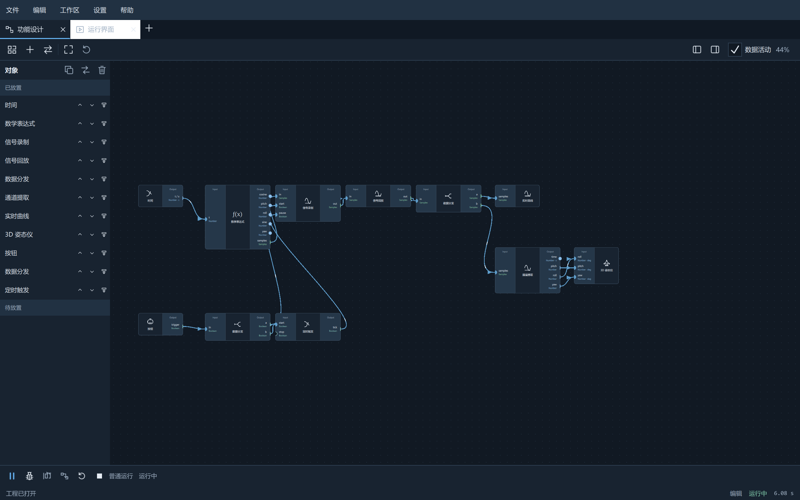
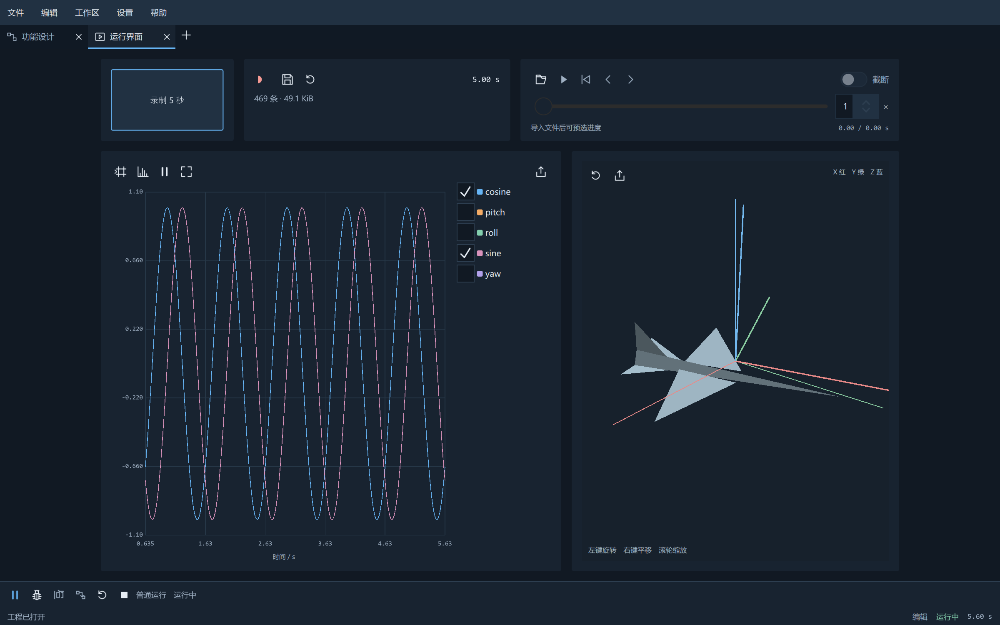

# 联调 · CoRig

**让人与 AI 一起搭建工程调试界面。**

调试设备、验证算法或观察数据时，经常需要把通信、协议解析、数据处理和控制面板临时拼在一起。CoRig 将这些能力放进同一套可组合的工具中：在功能设计里连接节点，在界面设计里安排曲线、姿态和控件，再把整套调试方案保存为可复用的工程。

AI 可以通过本地接口参与设计、运行、读取数据和检查结果；你可以直接查看和操作同一个工程。

[下载最新版本](https://github.com/xuyan623/CoRig/releases/latest) · [使用手册](docs/USER_GUIDE.md) · [本地 API](docs/API.md) · [版本说明](docs/RELEASE_NOTES.md)

## 从功能到界面

功能设计定义通信和数据如何流动，界面设计决定如何观察与控制。两者通过明确的绑定和同步操作协作。



同一个工程的运行界面可以同时显示实时曲线、三维姿态、录制回放和操作按钮。



以上为随包提供的 `RecordPlayback.crpj` 软件信号示例，无需连接硬件。

## 能做什么

| 能力 | 用途 |
|---|---|
| 通信与收发 | 串口、TCP、UDP、SSH；文本与 HEX、快捷指令、文件发送和接收记录 |
| 协议与数据处理 | 命名 ASCII/二进制、FireWater、JustFloat、JSON；通道提取、分发、数学表达式、滤波和积分微分 |
| 控制与时序 | 按钮、数值输入、开关、布尔逻辑、边沿识别、周期触发和倒计时 |
| 曲线与姿态 | 实时多通道曲线、FFT、原始 CSV 与图像导出；欧拉角/四元数及 STL/OBJ 模型显示 |
| 录制与回放 | 保存原始类型信号，暂停拼接、逐条查看、进度跳转及 0.125～16 倍速回放 |
| 运行调试 | 统一运行与暂停、整图/节点单步、输入输出和执行耗时检查、筛选日志 |
| AI 协作与扩展 | 本地 API、原生 CLI、真实数据与内部截图读取，以及 C++/Python 插件、树状导出和版本选择 |

官方功能使用原生 C++ / Qt Quick，**直接使用无需安装 Python**。仅在使用 Python 脚本或 Python 插件时，需要配置本机解释器。

## 快速上手

1. 从 [Releases](https://github.com/xuyan623/CoRig/releases/latest) 下载 `CoRigSetup-0.4.0-Windows-x64.exe` 安装程序，或完整解压 `CoRig-Windows-x64.zip` 便携包。
2. 双击解压目录中的 `CoRig.exe`，保留旁边的 DLL、`plugins/` 和 `qml/` 等目录。
3. 打开 `examples/FunctionLab.crpj`，点击底部运行按钮，即可看到持续变化的曲线和三维姿态。
4. 尝试 `RecordPlayback.crpj` 体验录制与回放，或打开 `SerialPlot.crpj` 验证软件串口回环，再按需要选择实际串口。

打开工程后，由你启动运行和连接。工程使用 `.crpj`，录制使用 `.crrc`；工程保存设计和配置，录制数据另存为独立文件。完整操作、快捷键和保存规则见[使用手册](docs/USER_GUIDE.md)。

## 与 AI 一起使用

运行 CoRig 后，AI 可通过本地 API 和 `CoRig-cli.exe` 查询插件、搭建功能与界面、运行调试、读取数据、获取内部截图，并保存或重开工程。GUI 与 API 使用同一套操作规则。

```powershell
.\CoRig-cli.exe api app.state
.\CoRig-cli.exe api registry
```

可将随包提供的 [corig Skill](skills/corig/SKILL.md) 交给支持技能的 AI 工具；具体接口、连接方法和扩展开发见下方文档。

## 文档

| 文档 | 内容 |
|---|---|
| [使用手册](docs/USER_GUIDE.md) | 示例、设计操作、运行控制、录制回放与 Python 配置 |
| [本地 API](docs/API.md) | GUI/CLI 共用命令、数据读取、界面操作及异步任务 |
| [插件开发](docs/PLUGIN_SDK.md) | 统一插件包、C++ SDK、Python 逻辑与 QML 视图 |
| [架构与设计约定](docs/ARCHITECTURE.md) | 模块职责、信号语义和界面实现约定 |
| [构建与发布](docs/BUILDING.md) | 开发环境、原生测试和便携包生成 |
| [验证范围](docs/VERIFICATION.md) | 已验证能力、性能测量及待实机验证项目 |
| [版本说明](docs/RELEASE_NOTES.md) | 当前发布内容与格式要求 |

## 源码与许可

仓库：[github.com/xuyan623/CoRig](https://github.com/xuyan623/CoRig)。当前提供 Windows x64 安装程序、便携包、插件 SDK 与对应源码包；其他平台尚未发布。

本项目采用 [LGPL-3.0](LICENSE)。项目来源和第三方组件许可见 [THIRD_PARTY_NOTICES.md](THIRD_PARTY_NOTICES.md) 与 [licenses/](licenses/)。
